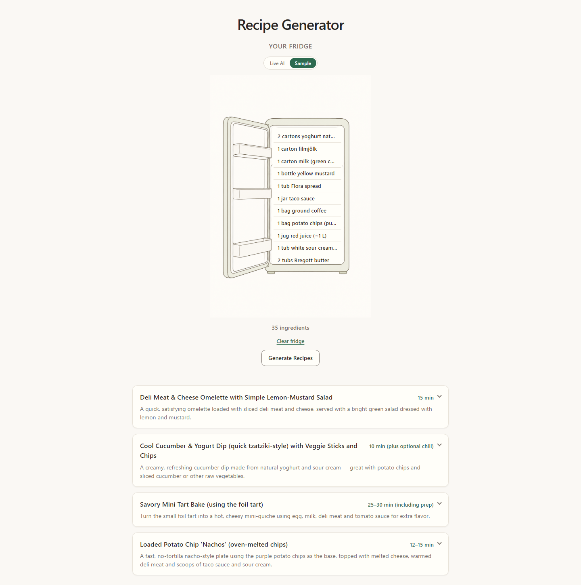

# Recipe Generator

Upload a fridge photo, detect the ingredients with AI, edit the list, and generate practical recipes you can cook from what you already have.

**Live demo:** [https://recipe-generator-web.vercel.app](https://recipe-generator-web.vercel.app)



## Features

- Live fridge photo analysis via vision models (Vercel AI Gateway)
- Sample mode with placeholder data (no API key needed)
- Editable ingredient list before recipe generation
- Client-side image compression so uploads stay under Vercel’s body size limit

## Stack

| Layer | Tech |
| --- | --- |
| Frontend | React 19, TypeScript, Vite |
| Backend | Hono, Zod, Vercel AI SDK |
| Deploy | Two Vercel projects (`Web` + `Backend`); frontend rewrites `/api` to the API |

## Local development

Requires [pnpm](https://pnpm.io/) and Node 20+.

### 1. Backend

```bash
cd Backend
cp .env.example .env
# Add AI_GATEWAY_API_KEY for live mode
pnpm install
pnpm run dev
```

API listens on `http://localhost:3000`.

### 2. Frontend

```bash
cd Web
pnpm install
pnpm run dev
```

App runs on `http://localhost:5173`. Vite proxies `/api` to the local backend.

## Environment

See [`Backend/.env.example`](Backend/.env.example):

| Variable | Required | Purpose |
| --- | --- | --- |
| `AI_GATEWAY_API_KEY` | For live mode | Authenticates calls through Vercel AI Gateway |
| `FRONTEND_URL` | Optional | Extra CORS origin (production frontend is also allowlisted in code) |

## Deploy

1. Create a Vercel project with **Root Directory** `Backend` (Hono default export).
2. Create a second project with **Root Directory** `Web` (Vite).
3. Set `AI_GATEWAY_API_KEY` on the backend project.
4. Point [`Web/vercel.json`](Web/vercel.json) rewrites at your API production domain.

## Copyright

Copyright © 2026 Lukas Ullenhag. All rights reserved.
